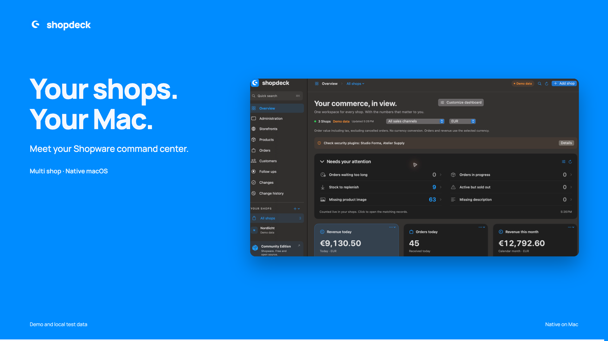
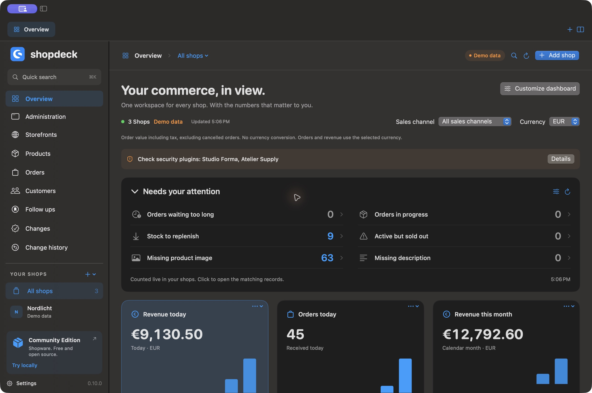

<p align="center"></p>
<h1 align="center">Shopdeck</h1>
<p align="center"><strong>Your Shopware command center. Native on Mac.</strong></p>
<p align="center">Manage your shops, understand your numbers and connect your commerce to Codex and Claude.</p>
<p align="center"><a href="https://github.com/sthamann/shopdeck/releases/latest/download/Shopdeck.dmg">Download for macOS</a> · <a href="docs/screenshots.md">Explore the app</a> · <a href="docs/ai-guide.md">Connect your AI</a> · <a href="https://www.shopware.com/en/community/community-edition/">Shopware Community Edition</a></p>

[](https://github.com/sthamann/shopdeck/releases/latest/download/Shopdeck-Intro-English.mp4)



Shopdeck brings multiple Shopware 6 shops into one native macOS workspace. Move between products, orders, customers, administrations and storefronts, with a local MCP server that makes those same shops available to your AI tools.

## A workspace for all your shops

| Work | What you get |
| --- | --- |
| Manage shops | Groups, drag and drop ordering, inline renaming, imported favicons, separate tabs and side by side administrations. |
| Browse your data | Products, orders and customers with server search, server filters, server sorting, keyboard navigation, CSV export, product thumbnails, custom columns and saved views. Open the full Shopware product editor for prices, variants and media. |
| Follow through | A live attention list for ageing orders, replenishment, sold out products and missing content. Private notes and dated follow ups on products, orders and customers. |
| Understand performance | 23 dashboard widgets, calendar month and year revenue, sales channel filters and separate currencies. Configure each widget for selected shops, duplicate it, move it or remove it. |
| Stay informed | Configurable rules for new order notifications, Shopware release notes rendered as Markdown and compatible Security Plugin version checks. |
| Use your AI | Guided Codex, Claude Desktop and Claude Code setup, installation detection, an MCP connection test, a tool catalogue and copyable example prompts. |
| Test locally | Download and install official Docker Desktop when needed, start a Dockware Shopware container, create API credentials and configure the local storefront automatically. Existing shops and occupied ports are detected; a shop name and free port are suggested automatically. |
| Feel at home on Mac | Light and dark appearance, six languages, menu bar statistics, a Dock order badge and native WidgetKit widgets for the desktop and Notification Center. |

### Lists that work on the full result set

Search terms, filters and sorting go to Shopware before pagination. The application merges sorted results from the selected shops into one page. It does not just sort the first 50 downloaded rows.

Settings provide rows per page and a maximum number of rows to load per shop. The configured result limit also bounds the combined pages you can browse. A visible message explains when the limit is reached. Shop names are local workspace metadata; sorting that column groups the remotely sorted records by shop. Structured JSON price array columns do not offer a misleading local sort button when Shopware has no direct field sort.

Select any combination of shops in each list. Saved views retain search, the selected shops, filters, sales channel, currency and sorting. Each entity has its own configurable columns and quick filters. CSV export follows the visible columns and their order. Export the current page or fetch the filtered result set, up to the configured limit, with cancellation and an explicit notice if the limit is reached. Spreadsheet formulas in text are neutralized.

### Know what to work on next

The dashboard attention list counts matching records directly in Shopware before pagination. It covers orders that have remained open too long, orders in progress, active products to replenish, sold out active products and parent products missing an image or description. Configure the stock threshold and the age of open orders. Click a count to open the matching list with the same shops, sales channel and order currency.

Content checks cover active parent products so inherited variant content is not mistaken for missing content. Counts respect the integration permissions. An unavailable shop produces an explicit error state rather than an invented zero. Queries run with bounded concurrency and a short cache to avoid unnecessary reloads.

Use **Notes and follow up** in any product, order or customer detail to keep a next step and an optional due date. **Follow ups** collects those tasks across shops, with search, due filters, completion, reopening and postponement. Open tasks are also reachable from the command palette. Notes stay private to this Mac and are not exposed by the MCP server or written to Shopware. Due dates are shown in the app; they do not schedule macOS notifications.

### Your numbers, your way

Choose today, 7 day or 30 day revenue and orders, calendar month and year revenue, monthly trends, average order value, shop rankings, recent orders, open and cancelled orders, shipping revenue, payment and delivery status, product and customer counts, low stock and connection status.

Revenue is order value including tax, excluding cancelled orders. Currencies remain separate without implicit conversion. Calendar month and year revenue use Shopware server aggregations. Detailed operational metrics use up to 10,000 orders per shop from the last 30 days and disclose incomplete data. Product and customer counts describe whole shops.

Native macOS widgets offer all 23 metrics. The gallery includes dedicated starting points for revenue, orders, products, customers, stock, rankings and connections. Edit a widget to choose another metric, a shop or sales channel, and currency. Widgets show the last data loaded by Shopdeck, with an update time; the extension does not store API keys.

## Getting started

1. Download the disk image from [GitHub Releases](https://github.com/sthamann/shopdeck/releases/latest) and move Shopdeck into Applications. The current binary is for Apple silicon and macOS 14 or later.
2. The first launch assistant selects your computer language, with English as fallback, and guides you through connecting a shop and optional AI access. Add a Shopware 6 shop. In its administration, create an integration under **Settings → System → Integrations** and use its access ID and secret. Grant the integration the permissions you need.
3. Or choose **Try locally** to provision a local Shopware environment. On first launch, Docker may require you to accept its own terms and complete its initial setup. Shopdeck waits for the engine to become ready.
4. Local Docker shops show the default administration login, **admin / shopware**, directly above the embedded login page, with copy buttons. These are the image defaults; a password you change yourself takes precedence.
5. Open **Codex & Claude** when you want AI access. Enable only the shops you want to share, configure your client and try the included prompts.

Version 0.9.1 ships an optimized Developer ID signed app with Apple notarization and a stapled ticket, inside a Developer ID signed disk image. Read the [release notes](docs/releases.md) for the distribution checks.

## Connect Codex and Claude

The bundled stdio MCP server exposes 20 tools. It supports explicit shop selection, record searches and details, product proposals, a generic Admin API bridge, reviewed writes and discovery of Shopware’s own MCP tools.

Reads follow the Shopware integration’s permissions. Writes are proposals until you review and approve them in Shopdeck. Customer data has a separate per shop sharing switch. Credentials are kept in the macOS Keychain and passed to the signed helper through pipes.

Codex and Claude Code receive their MCP configuration and Shopdeck skill automatically. Claude Desktop receives its MCP configuration; import the exported skill ZIP in Claude Desktop’s Skills settings. Existing configuration is backed up before editing.

Try this in a new chat after restarting the client:

> Use Shopdeck to list my enabled shops with their names and shop IDs. Do not change any data.

See the [AI guide](docs/ai-guide.md) for comparisons, products, orders and reviewed changes. The [tool catalogue](docs/mcp-tools.json) contains the actual server schemas.

### From an idea to a reviewed campaign

Prepare text, local artwork and product sliders with `propose_campaign`. Shopdeck displays the sections, files and target shop together. Approval uploads real binary media, creates the CMS page and landing page, then independently reads back the saved slot configuration. Drafts stay inactive. Explicit publication checks the storefront URL, including Shopware SEO redirects, and reports reachability separately.

`propose_media_upload` supports local PNG, JPEG, WebP and GIF files. `propose_plugin_install` validates a plugin ZIP, shows its version and required Shopware version, then uploads, installs and optionally activates it after approval. It verifies the resulting plugin record. Existing installed plugins need a separate update operation.

Approve multiple proposals with **Apply all**, inspect current and proposed product values, choose the selection and follow progress. Processing stops on a failure. Product batch changes have guarded undo in reverse order; newer external edits cause a conflict instead of being overwritten. The history also records general API actions, media, plugins, campaigns and native MCP calls, with their actual verification level.

Shopware’s native capability catalogue and current session tool list are shown separately. Use `call_shopware_tool` to invoke native tools when the shop makes them available. A catalogue entry alone does not establish availability.

## Build and run

You need a Mac, Xcode with the command line tools, and XcodeGen for the WidgetKit extension.

```sh
brew install xcodegen
swift test --disable-sandbox
script/build_and_run.sh --demo
```

Local builds use ad hoc signing by default. To build only the main app without the native widget extension:

```sh
SHOPDECK_SKIP_WIDGETS=1 script/build_and_run.sh --build-only
```

For WidgetKit data sharing, use an Apple signing identity and configure your own Team ID in the App Group in `Widgets/App.entitlements`, `Widgets/Widget.entitlements` and `Sources/ShopdeckCore/WidgetSnapshot.swift`. The checked in group belongs to the publisher of the official builds. Development signing is sufficient for testing widgets on your own Mac.

```sh
SHOPDECK_SIGN_IDENTITY="Developer ID Application: Your Name (TEAMID)" \
  script/build_and_run.sh --build-only
```

For direct public distribution, sign all executable components with Developer ID and hardened runtime, notarize with Apple and staple the ticket. See [the release guide](docs/releases.md). Sparkle checks the signed appcast hosted in the latest GitHub Release. Private signing keys and API credentials are never part of this repository.

## Project structure

- `Sources/Shopdeck`: SwiftUI and AppKit macOS application.
- `Sources/ShopdeckCore`: Shopware API client, federated search, persistence, analytics, notification rules, proposal review and MCP implementation.
- `Sources/ShopdeckMCP`: stdio MCP entry point.
- `Sources/ShopdeckKeychain`: stable signed credential helper.
- `Widgets`: WidgetKit extension and shared snapshot model.
- `Tests`: API, pagination, sorting, scope, persistence and change approval regressions.
- `script`: build, archive, signing and release tools.

The test suite includes a separate live integration test for an isolated local Dockware shop. It is opt in because it creates an integration and verifies a reversible stock change.

## Languages

Deutsch · English · Nederlands · Español · Français · Italiano

## License and credits

Shopdeck code is released under the [MIT License](LICENSE). Shopware names and emblems are trademarks of Shopware AG and retain their own rights. Shopdeck is an independent project. The Shopware Community Edition is available from [Shopware](https://www.shopware.com/en/community/community-edition/).

Sparkle, MarkdownUI, NetworkImage and swift-cmark notices are included in [ThirdPartyNotices](Assets/ThirdPartyNotices.txt) and in the application bundle.
