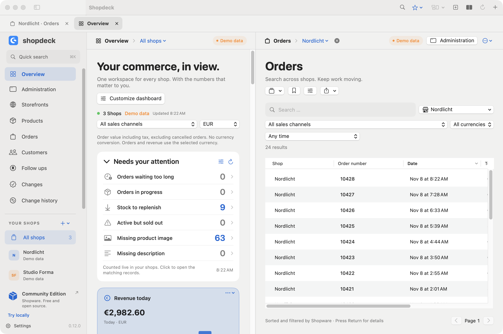
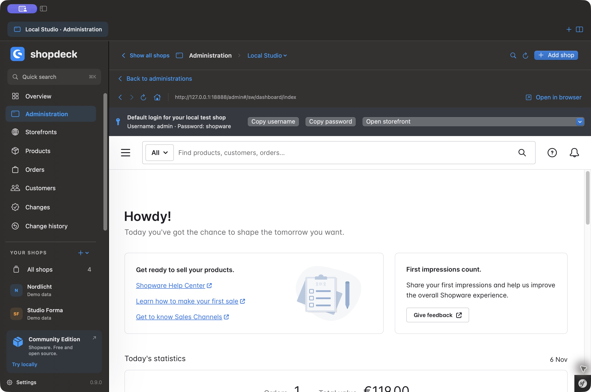

<p align="center"></p>
<h1 align="center">Shopdeck</h1>
<p align="center"><strong>Run your Shopware shops from one Mac.</strong></p>
<p align="center"><a href="https://github.com/sthamann/shopdeck/releases/latest/download/Shopdeck.dmg">Download for macOS</a> · <a href="docs/video.md">Watch the 30 second tour</a> · <a href="docs/screenshots.md">See the app</a> · <a href="#open-the-shopware-administration">Shopware administration</a> · <a href="#control-shopware-with-codex-and-claude">AI control</a></p>

Shopdeck is a native macOS app for Shopware 6. Open your shops in one place, find orders and products across them, and keep the Shopware administration or storefront a click away. It is free and open source.

[](docs/screenshots.md#workspace-preview-from-the-main-branch)

**Get started with the signed and notarized 0.13.0 release** on Apple silicon with macOS 14 or later. Connect an existing shop, start a local Shopware shop with Docker, or explore the built in demo. The screenshot above shows the workspace with demo shops. [Stable release](https://github.com/sthamann/shopdeck/releases/tag/v0.13.0) · [Build from source](#build-and-run)

## A morning with Shopdeck

1. **Check what needs attention.** Start with ageing orders, low stock and missing product content. Click a count to open the matching records across the selected shops.
2. **Find an order and do the work.** Search by order number, switch shops or reuse a saved view. Select orders to build a printable picking list or download their existing invoices and delivery notes.
3. **Keep track of the next step.** Bookmark a record, leave a private note or set a follow up with an optional macOS reminder.
4. **Give your AI a shop connection you control.** Connect Codex or Claude through the local MCP server, choose which shops it can access and review proposed writes before applying them.

[Watch the English product tour](https://github.com/sthamann/shopdeck/releases/download/v0.12.0/Shopdeck-Tour-English.mp4) · [Vertical edition for LinkedIn](docs/video.md)

## Open the Shopware administration

Choose **Administration** in the sidebar and select a connected shop. Shopdeck opens the real Shopware admin inside the app. Log in as usual to manage variants, promotions, extensions or anything else you use in the admin. Each shop has a separate browser session. Use **Open in browser** to continue on the current page in your browser.

Right click a shop and choose **Open in new tab** or **Open side by side**. Keep two shop administrations open, or put one beside an order list or the dashboard. Each tab keeps its own shop and filters. Use the **Workspaces** menu to save a setup you want to reopen. The **Storefronts** view lists the domains by sales channel with their language and currency, and opens each one in Shopdeck or in your browser.

[](docs/screenshots.md#your-actual-shopware-interfaces)

## A workspace for all your shops

| Work | What you get |
| --- | --- |
| Manage shops | Groups, drag and drop ordering, inline renaming, imported favicons, persistent tabs, named workspaces and side by side administrations. |
| Browse your data | Products, orders and customers with server search, server filters, server sorting, keyboard navigation, CSV export, product thumbnails, custom columns, dynamic date periods and saved views. Open the full Shopware product editor for prices, variants and media. |
| Pick and pack | Build a picking list from selected orders across shops. Check items with the keyboard, open their orders and export a printable PDF or CSV. Physical quantities stay separate by shop and variant. |
| Follow through | A live attention list for ageing orders, replenishment, sold out products and missing content. Private notes and dated follow ups on products, orders and customers, with optional macOS reminders. |
| Work with documents | Preview existing invoices, delivery notes and credit notes in PDFKit. Download originals or ZIP packages from selected orders across shops. |
| Understand performance | 23 dashboard widgets, calendar month and year revenue, sales channel filters and separate currencies. Configure each widget for selected shops, duplicate it, move it or remove it. |
| Stay informed | Configurable rules for new order notifications, Shopware release notes rendered as Markdown and compatible Security Plugin version checks. |
| Use your AI | Guided Codex, Claude Desktop and Claude Code setup, installation detection, an MCP connection test, a tool catalogue and copyable example prompts. |
| Test locally | Download and install official Docker Desktop when needed, start a Dockware Shopware container, create API credentials and configure the local storefront automatically. Existing shops and occupied ports are detected; a shop name and free port are suggested automatically. |
| Feel at home on Mac | Light and dark appearance, six languages, menu bar statistics, a Dock order badge and native WidgetKit widgets for the desktop and Notification Center. |

### Lists that work on the full result set

Search terms, filters and sorting go to Shopware before pagination. The application merges sorted results from the selected shops into one page. You can sort and filter across all matching pages within your configured limits.

Settings provide rows per page and a maximum number of rows to load per shop. The configured result limit also bounds the combined pages you can browse. A visible message explains when the limit is reached. Shop names are local workspace metadata; sorting that column groups the remotely sorted records by shop. Structured JSON price array columns do not offer a misleading local sort button when Shopware has no direct field sort.

Select any combination of shops in each list. Saved views retain search, the selected shops, filters, sales channel, currency and sorting. Each entity has its own configurable columns and quick filters. CSV export follows the visible columns and their order. Export the current page or fetch the filtered result set, up to the configured limit, with cancellation and an explicit notice if the limit is reached. Spreadsheet formulas in text are neutralized.

### Know what to work on next

The dashboard attention list counts matching records directly in Shopware before pagination. It covers orders that have remained open too long, orders in progress, active products to replenish, sold out active products and parent products missing an image or description. Configure the stock threshold and the age of open orders. Click a count to open the matching list with the same shops, sales channel and order currency.

Use the sliders on **Needs your attention** to pick individual checks, set thresholds and show or hide due follow ups. Turn off **Show attention list** to hide the panel and stop its checks. The same switch is under **Settings → Dashboard**, where you can turn it back on. [See the attention list settings](docs/screenshots/60-attention-list-settings.png)

Content checks cover active parent products so inherited variant content is not mistaken for missing content. Counts respect the integration permissions. An unavailable shop produces an explicit error state rather than an invented zero. Queries run with bounded concurrency and a short cache to avoid unnecessary reloads.

Use **Notes and follow up** in any product, order or customer detail to keep a next step and an optional due date. **Follow ups** collects those tasks across shops, with search, due filters, completion, reopening and postponement. Open tasks are also reachable from the command palette. Notes stay private to this Mac and are not exposed by the MCP server or written to Shopware. Enable a macOS reminder for a future due date to receive a notification even when the app is closed. Clicking it opens the linked record. Your note is excluded from the notification. Completion and postponement update the scheduled reminder. Notification permission is requested only when you choose to enable a reminder.

### Pick up where you left off

In the workspace preview, **⌘K** opens quick actions, bookmarks and follow ups. Type a shop name to change the scope of your current view, or type an order number and choose **Orders** to search Shopware. The shop menu at the top of the view switches to **All shops**. Use **⌘T** for another tab and **⌘⇧D** to see two tabs side by side.

Tabs reopen with their selected shops, search, filters, sorting, page, sales channel and currency. Save a named workspace for a recurring routine, such as morning order checks beside your replenishment list. Duplicate tabs, close other tabs, or reopen the last closed tab with **⌘⇧T**. Turn automatic restoration off in the **Workspaces** menu if you prefer a fresh start.

### Keep your order documents together

Select orders in the grid and choose **Open documents**, or open documents from an order detail. Preview existing invoices, delivery notes and credit notes without leaving the app. Search the document list and select several PDFs with **⌘** or **⇧**. Exports preserve the original bytes, including existing signatures, and group files by shop in a ZIP package. To generate a new document, open the order and choose **Open in Administration**. In Shopware, open **Documents** and create the invoice or delivery note there. Then refresh **Order documents** in Shopdeck to preview or save the PDF returned by Shopware.

The integration needs `document:read` and access to the selected orders. Each PDF is limited to 32 MB and an export package to 256 MB. Up to 200 selected orders per shop and 1,000 documents per shop are loaded; incomplete lists are disclosed. Binary downloads stay on the selected shop origin and do not follow redirects.

### Pick once, know where every item belongs

Select up to 200 orders and choose **Picking list**. Shopdeck reloads the order status and all line items with server pagination, then combines matching physical product positions by shop, product identity and historical SKU. Variants and different shops remain separate. Cancelled orders, digital products and non product positions are excluded with visible counts. A failed or incomplete shop blocks the list rather than quietly returning partial quantities.

Check a row with **Space**, use **Return** to open its order and follow each allocation back to an order number. Search the list, filter by shop or show only unchecked items. Export the visible rows as CSV or a printable PDF, including quantities, check marks and order allocations. Markings belong to the current picking list and never change stock or order status. Each shop can load up to 10,000 positions per selected batch. Orders deliberately selected after completion remain included; the list is a picking aid, not an automatic shipment action.

### Save the records you return to

Click the star in a product, order or customer detail. Bookmarks are grouped by shop in the top toolbar and are also searchable with **⌘K**. They reopen fresh record details and survive restarting the app. Bookmarks stay on this Mac.

**Today**, **Yesterday**, **Last 7 days**, **Last 30 days**, **This month**, **Last month** and **This year** filter the order date or the creation date of products and customers before server pagination. Saved views retain the relative period, so “Today” means today when you next open it. Calendar boundaries use the Mac’s time zone, including daylight saving changes. A single federated load freezes its time window across shops and pages.

### Your numbers, your way

Choose today, 7 day or 30 day revenue and orders, calendar month and year revenue, monthly trends, average order value, shop rankings, recent orders, open and cancelled orders, shipping revenue, payment and delivery status, product and customer counts, low stock and connection status.

Revenue is order value including tax, excluding cancelled orders. Currencies remain separate without implicit conversion. Calendar month and year revenue use Shopware server aggregations. Detailed operational metrics use up to 10,000 orders per shop from the last 30 days and disclose incomplete data. Product and customer counts describe whole shops.

Native macOS widgets offer all 23 metrics. The gallery includes dedicated starting points for revenue, orders, products, customers, stock, rankings and connections. Edit a widget to choose another metric, a shop or sales channel, and currency. Widgets show the last data loaded by Shopdeck, with an update time; the extension does not store API keys.

## Getting started

1. Download the disk image from [GitHub Releases](https://github.com/sthamann/shopdeck/releases/latest) and move Shopdeck into Applications. The current binary is for Apple silicon and macOS 14 or later.
2. The first launch assistant selects your computer language, with English as fallback, and guides you through connecting a shop and optional AI access. Add a Shopware 6 shop. In its administration, create an integration under **Settings → System → Integrations** and use its access ID and secret. Grant the integration the permissions you need.
3. Or choose **Try locally** to provision a local Shopware environment. On first launch, Docker may require you to accept its own terms and complete its initial setup. Shopdeck waits for the engine to become ready.
4. Local Docker shops show the default administration login, **admin / shopware**, directly above the embedded login page, with copy buttons. These are the image defaults; a password you change yourself takes precedence.
5. Open **Codex & Claude** when you want AI access. Enable only the shops you want to share, configure your client and try the included prompts.

Version 0.13.0 ships an optimized Developer ID signed app with Apple notarization and a stapled ticket, inside a Developer ID signed disk image. Read the [release notes](docs/releases.md) for the distribution checks.

## Control Shopware with Codex and Claude

Open **Codex & Claude**, enable the shops the client should see and use **Check now** to test the bundled local MCP server. Shopdeck can configure Codex, Claude Code and Claude Desktop. Codex and Claude Code get the Shopdeck skill during setup. Claude Desktop users import the exported skill ZIP under **Settings → Skills**. Restart the client and open a new chat.

> Use Shopdeck to list my enabled shops with their names and shop IDs. For each shop, show the product count and the number of low stock products. Keep the results separate by shop.

| What you can ask for | What Shopdeck does |
| --- | --- |
| Find products, look up orders or compare sales channels | Reads the selected shop and returns the requested fields. Customer access follows a separate per shop setting. |
| Change a product's description or stock | Prepares a proposal with the current and proposed values. You review it under **Changes**. |
| Read a different entity or prepare an Admin API action | Discovers the shop's schema and routes, then uses the general bridge for permitted reads or queues the requested write or action. |
| Upload an image or install a plugin from a local file | Stages the file for review. After approval it can upload the image or upload, install and optionally activate a compatible plugin package. |
| Prepare a landing page with text, images and products | Stages a campaign plan with its target shop and sales channel. Approval creates the Shopware CMS and landing page. |
| Use a tool exposed by Shopware itself | Discovers native MCP tools for that shop. Supported reads can run directly. Mutations and configuration access go through Shopdeck review. |

The local MCP server exposes 20 tools. Each shop operation names an explicit shop ID. The generic bridge can work with entities and actions exposed by the connected shop, including custom entities. What the client can read or change depends on the integration's permissions, the shop's routes and Shopdeck's access rules. API credentials stay in the macOS Keychain. [Example prompts and setup](docs/ai-guide.md) · [Exact tool schemas](docs/mcp-tools.json)

### Review changes before they reach the shop

Try a product correction first. Ask the client to find an item by SKU and propose a new description. Open **Changes** and review the target shop, current value and proposed value. **Apply all** lets you review a selection and stops on failure. **Change history** records what was applied and how it was verified. Product batches support guarded undo when the current values still match the applied change.

### Prepare a campaign as a draft

For a connected shop, ask the client to use `propose_campaign` with a storefront sales channel, existing product IDs and any local artwork. Set `publish=false` to prepare an inactive landing page. Shopdeck checks the selected channel and products and stages the files. In **Changes** you can inspect the plan and files before approval.

Approval uploads the files, creates the CMS page and landing page, and reads back the saved content. The receipt includes the Shopware IDs. Explicit publication also checks whether the storefront URL can be reached. Saved content and storefront reachability are reported separately.

## Build and run

You need a Mac, Xcode with the command line tools, and XcodeGen for the WidgetKit extension.

```sh
brew install xcodegen
swift test --disable-sandbox
script/build_and_run.sh --demo
```

Local builds use ad hoc signing by default. To build only the main app without the native widget extension:

```sh
SHOPDECK_SKIP_WIDGETS=1 script/build_and_run.sh --build-only
```

For WidgetKit data sharing, use an Apple signing identity and configure your own Team ID in the App Group in `Widgets/App.entitlements`, `Widgets/Widget.entitlements` and `Sources/ShopdeckCore/WidgetSnapshot.swift`. The checked in group belongs to the publisher of the official builds. Development signing is sufficient for testing widgets on your own Mac.

```sh
SHOPDECK_SIGN_IDENTITY="Developer ID Application: Your Name (TEAMID)" \
  script/build_and_run.sh --build-only
```

For direct public distribution, sign all executable components with Developer ID and hardened runtime, notarize with Apple and staple the ticket. See [the release guide](docs/releases.md). Sparkle checks the signed appcast hosted in the latest GitHub Release. Private signing keys and API credentials are never part of this repository.

## Project structure

- `Sources/Shopdeck`: SwiftUI and AppKit macOS application.
- `Sources/ShopdeckCore`: Shopware API client, federated search, persistence, analytics, notification rules, proposal review and MCP implementation.
- `Sources/ShopdeckMCP`: stdio MCP entry point.
- `Sources/ShopdeckKeychain`: stable signed credential helper.
- `Widgets`: WidgetKit extension and shared snapshot model.
- `Tests`: API, pagination, sorting, scope, persistence and change approval regressions.
- `script`: build, archive, signing and release tools.

Live integration tests are opt in and use the isolated local Dockware verification shop. They cover reversible product changes and disposable document and picking fixtures. Fixtures are removed and original records are checked afterwards.

## Languages

Deutsch · English · Nederlands · Español · Français · Italiano

## Support

See [Support](docs/support.md) for connection troubleshooting and [Privacy](docs/privacy.md) for how Shopdeck handles your data. [Shopware Community Edition](https://www.shopware.com/en/community/community-edition/) is available from Shopware.

## License and credits

Shopdeck code is released under the [MIT License](LICENSE). Shopware names and emblems are trademarks of Shopware AG and retain their own rights. Shopdeck is an independent project. The Shopware Community Edition is available from [Shopware](https://www.shopware.com/en/community/community-edition/).

Sparkle, MarkdownUI, NetworkImage and swift-cmark notices are included in [ThirdPartyNotices](Assets/ThirdPartyNotices.txt) and in the application bundle.
