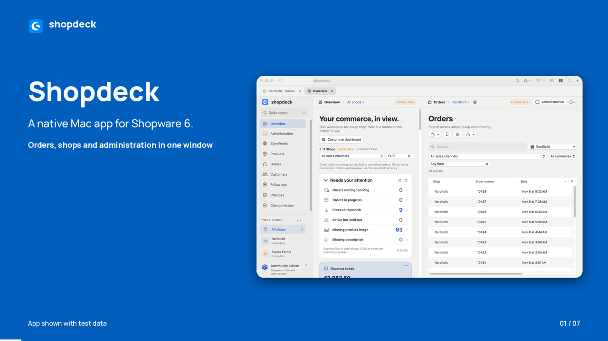

# Shopdeck films

## 30 second product tour

The 30 second tour uses English text on screen and plays silently. It shows the native Mac workspace, quick search, picking, the local MCP connection for Codex and Claude, approval of proposed changes, and the dashboard widget gallery.

- [Landscape film, 1920 × 1080](https://github.com/sthamann/shopdeck/releases/download/v0.12.0/Shopdeck-Tour-English.mp4)
- [Vertical film for LinkedIn, 1080 × 1350](https://github.com/sthamann/shopdeck/releases/download/v0.12.0/Shopdeck-Tour-LinkedIn-English.mp4)

## Archive: Shopdeck 0.12 tour

The original 30 second English tour shows Shopdeck 0.12 with demo and local test data.

- [Watch or download the landscape film, 1920 × 1080](https://github.com/sthamann/shopdeck/releases/download/v0.12.0/Shopdeck-Intro-English.mp4)
- [Download the LinkedIn feed edition, 1080 × 1350](https://github.com/sthamann/shopdeck/releases/download/v0.12.0/Shopdeck-LinkedIn-English.mp4)
- [Download the English captions](https://github.com/sthamann/shopdeck/releases/download/v0.12.0/Shopdeck-Intro-English.srt)

The film covers multi shop search, relative date filters, bookmarks, picking lists and printable exports, order PDFs, follow ups, Codex and Claude with reviewed changes, dashboard metrics, native desktop widgets, saved workspaces and local Docker test shops.

The archived 0.12 tour includes English narration and music.

The app and its releases remain available at [sthamann/shopdeck](https://github.com/sthamann/shopdeck).
